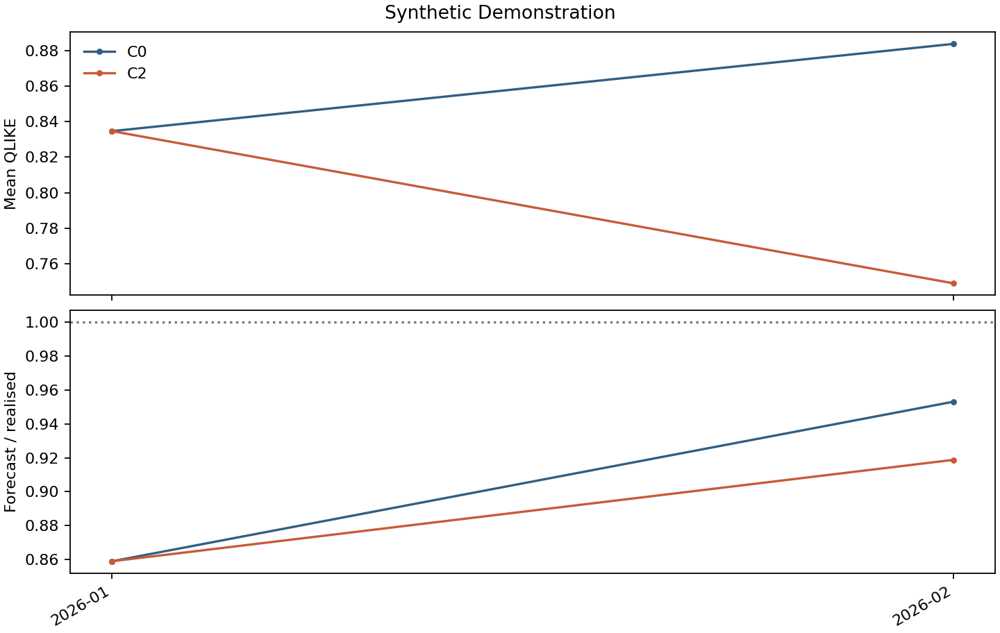
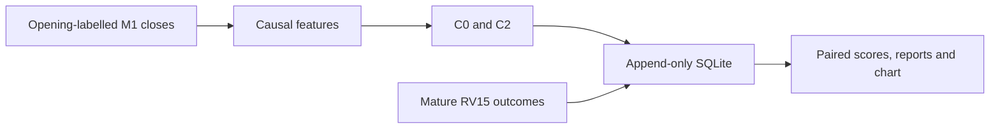

# RV15 Forecasting Engine

[](https://github.com/Tolbert-Okoth/rv15-forecasting-engine/actions/workflows/tests.yml)


RV15 is an offline Python research application for forecasting the next 15 minutes of realised price variance. It reconstructs completed-bar features, records immutable forecasts and outcomes in SQLite, and compares forecasts on identical targets. Volatility tends to cluster and vary with the trading session. A variance forecast measures expected fluctuation intensity and supports calibration research.



## Install and run

Python 3.11 is tested. From this repository's root:

**PowerShell**

```powershell
py -3.11 -m venv .venv
.\.venv\Scripts\python.exe -m pip install .
.\.venv\Scripts\rv15.exe demo --out outputs/demo
.\.venv\Scripts\rv15.exe evaluate --ledger outputs/demo/demo.sqlite --out outputs/evaluation
.\.venv\Scripts\python.exe -m unittest discover -s tests -v
```

**POSIX shell**

```sh
python3.11 -m venv .venv
.venv/bin/python -m pip install .
.venv/bin/rv15 demo --out outputs/demo
.venv/bin/rv15 evaluate --ledger outputs/demo/demo.sqlite --out outputs/evaluation
.venv/bin/python -m unittest discover -s tests -v
```

The demo generates its own prices and uses explicitly unfitted software-test constants with distinct identities. It exercises both forecast paths, the ledger and reporting without the historical model bundle. Open `outputs/demo/REPORT.md`, `metrics.json` and `quality.png`. Repeat the command to exercise identical replay protection.

## Forecast and calibration

For an origin t, RV15 is the sum of squared one-minute log returns for the next 15 completed closes, anchored on the close at t. The frozen HAR-style C0 predicts log variance using trailing RV15, trailing RV60, previous completed-session variance, and a fitted quarter-hour seasonal term. It exponentiates, applies the original smearing correction and floors the result with q = log(1 + 0.001 / price)². The three trailing features and the seasonal value are floored before taking logs.

C2 multiplies C0 by a prior-session factor and reapplies the floor. The factor uses an EWMA of the prior eligible sessions' mean of max(RV15, q) / C0. It starts at one, has a ten-session half-life, stays at one for fewer than 20 matured sessions, is clipped to [0.5, 2], and remains fixed within a session. The archival outcome maturity convention is 16 minutes after nominal origin.



QLIKE is r − log(r) − 1, where r is floored realised variance divided by forecast variance. Lower is better. Reports include paired C0-minus-C2 QLIKE differences, relative gains, sum-of-forecasts divided by sum-of-raw-realised calibration, and chronological and distributional diagnostics.

## Use your own history

Provide appropriately licensed data in CSV format. Use sorted, unique opening-minute timestamps with explicit UTC offsets, a positive finite close, and optionally a source label. Gaps and source changes invalidate crossing windows. The feature builder needs 61 consecutive completed closes and a previous eligible weekday session with at least 1,200 consecutive one-minute intervals inside that session.

```csv
open_time,close,source
2026-01-06T00:00:00Z,2000.10,example
2026-01-06T00:01:00Z,2000.12,example
```

Historical model execution requires an authorized external frozen manifest, which is excluded from this distribution. Supply a manifest containing `model.frozen`, `model.training_season_by_slot`, `c0`, `c2`, `c2_spec` and `bucket_cuts`. The engine validates the frozen identities and bucket fingerprint. Keep the manifest and datasets outside the repository.

```text
rv15 validate --model path/to/model-manifest.json --dataset path/to/m1.csv
rv15 replay --model path/to/model-manifest.json --dataset path/to/m1.csv --ledger outputs/history.sqlite
rv15 evaluate --model path/to/model-manifest.json --ledger outputs/history.sqlite --out outputs/history
```

## Results and status

The original research verified 68,291 retrospective forecast origins. HAR improved primary QLIKE versus EWMA by 23.37% and additional 2026 QLIKE by 18.24%. C2 improved 2026 QLIKE versus HAR by 2.94% and by 1.90% on the LATE01 tick-matched subset. The samples overlap, and the C2 gains were concentrated in extremes. The standalone demo reproduces the software workflow. Full historical parity requires the original authorized artifacts and frozen evaluation population.

The project is a completed offline research engine. Variance forecasts do not establish direction prediction, trading profitability or prospective superiority. Historical completion and archived quote-event times do not establish live receipt. See [research findings](docs/RESEARCH_FINDINGS.md), [model card](docs/MODEL_CARD.md), [architecture](docs/ARCHITECTURE.md), [reproducibility](docs/REPRODUCIBILITY.md) and [limitations and rights](docs/LIMITATIONS.md).

MIT licensed (code only; see [limitations and rights](docs/LIMITATIONS.md)).
