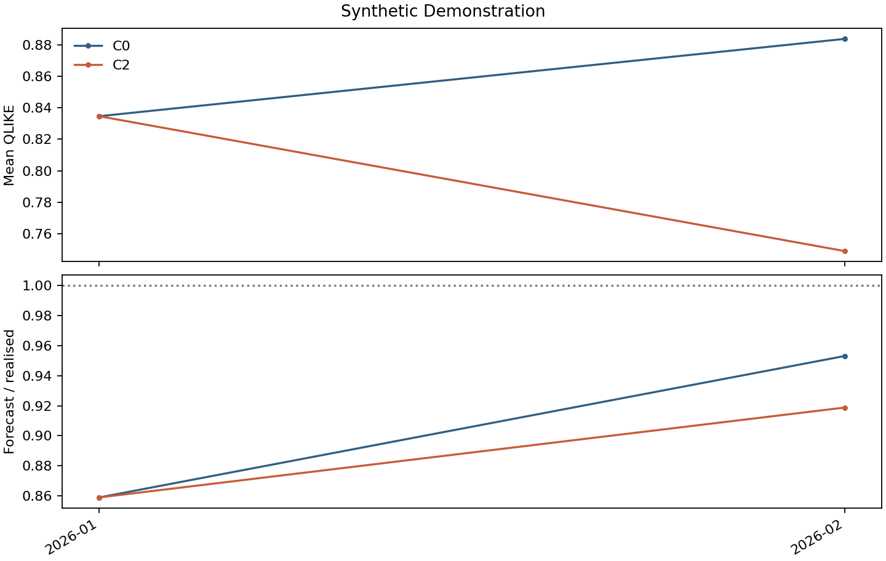

# Synthetic software demonstration

This run used seeded generated prices and unfitted fixture constants. It exercised both forecast paths and produced an append-only SQLite ledger, an aggregate report and a chart.

| Metric | Result |
| --- | ---: |
| Monitored sessions | 23 |
| Forecast opportunities | 1,932 |
| Paired outcomes | 1,909 |
| Missing targets | 23 |
| C0 fixture QLIKE | 0.858164 |
| C2 fixture QLIKE | 0.793667 |
| C0 fixture aggregate calibration | 0.890093 |
| C2 fixture aggregate calibration | 0.878785 |

A second invocation returned the same scored population and metrics. The numerical differences between fixture C0 and C2 do not measure empirical performance.

